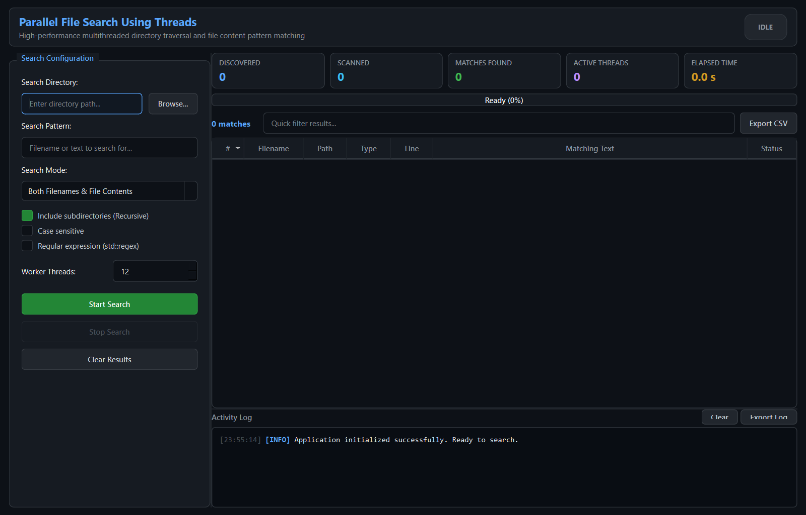
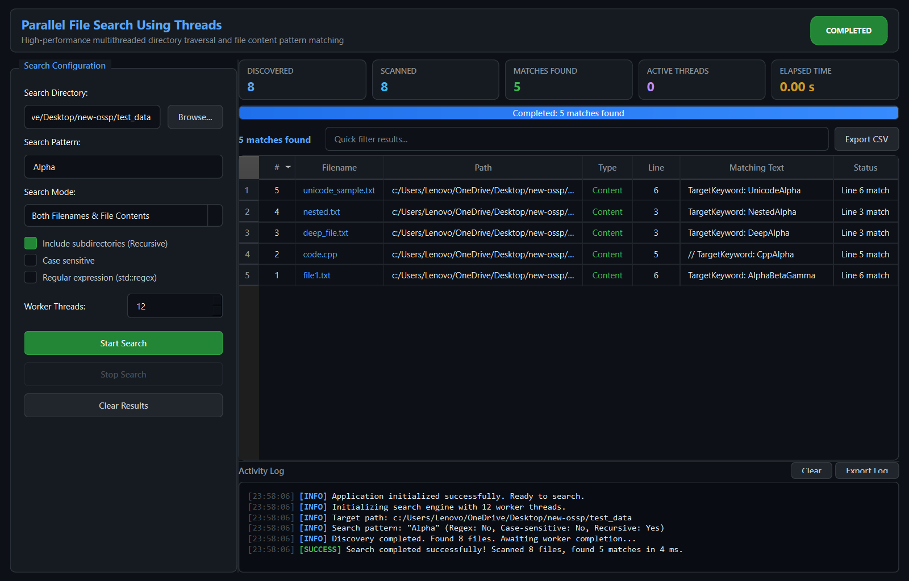

# Parallel File Search - User Guide

## 1. Introduction

**Parallel File Search Using Threads** is a desktop file search tool designed for developers, systems engineers, and power users who need to search through large directory trees and file contents concurrently without GUI lag.

---

## 2. Interface Walkthrough

The application window is split into three main operational sections:

### 1. Left Sidebar — Search Configuration
- **Search Directory:** Enter the target directory path or click **Browse...** to select a folder using the system file picker.
- **Search Pattern:** Enter the text or regular expression to find. Pressing `<Enter>` in this field triggers the search immediately.
- **Search Mode:**
  - *Both Filenames & File Contents:* Matches if the filename contains the pattern OR if any line inside the file contains the pattern.
  - *Filenames Only:* Searches directory entries by name only (fastest mode for file location).
  - *File Contents Only:* Inspects inside files, skipping binary files automatically.
- **Include subdirectories (Recursive):** When checked, scans all child folders recursively. When unchecked, scans only the immediate directory.
- **Case sensitive:** Toggles case sensitivity for matching.
- **Regular expression (`std::regex`):** Enables ECMAScript regular expression matching (e.g., `\[ERROR\]\s+\d+`). If an invalid regex syntax is entered, a validation alert explains the syntax error.
- **Worker Threads:** Configures the number of parallel worker threads (1 to 64). The app automatically defaults to your machine's logical CPU core count (e.g., 12 or 16 threads).
- **Start Search / Stop Search / Clear Results:** Primary controls to run, halt, or reset the search.

---

### 2. Main Dashboard & Results

- **Top Stat Cards:**
  - **Discovered:** Total number of files discovered across directories.
  - **Scanned:** Number of files inspected by worker threads.
  - **Matches Found:** Total matches found (filename + content lines).
  - **Active Threads:** Real-time count of worker threads actively searching files.
  - **Elapsed Time:** Monotonic search duration measured in seconds with millisecond precision.
- **Progress Bar:** Displays actual work completion percentage based on files scanned divided by files discovered.
- **Quick Filter:** Type any text to instantly filter the results table in-memory without re-running the search.
- **Sortable Results Table:** Click any header column (`#`, `Filename`, `Path`, `Type`, `Line`, `Matching Text`, `Status`) to sort ascending or descending.
- **Export CSV:** Exports all matching records to an RFC 4180 CSV file with UTF-8 BOM encoding for direct opening in Microsoft Excel.

#### Interacting with Results:
- **Double-Click:** Automatically opens the file with your system's default application (e.g., Notepad, VS Code, or web browser).
- **Right-Click Context Menu:**
  - *Open File:* Launches the file.
  - *Open Containing Folder:* Opens File Explorer with the directory selected.
  - *Copy Full Path:* Copies the absolute file path to the clipboard.
  - *Copy Matching Text:* Copies the matched snippet/line to the clipboard.

---

### 3. Bottom Panel — Activity Log
- Displays real-time operational events, thread pool initialization details, directory scan metrics, warnings for inaccessible or skipped files, and completion statistics.
- Events are color-coded:
  - **[INFO]** Engine setup, file count, and progress milestones.
  - **[SUCCESS]** Search completed successfully with summary metrics.
  - **[WARN]** Skipped files, permission issues, or cancellation notice.
  - **[ERROR]** Unrecoverable errors or invalid directory paths.
- **Clear:** Clears the log view.
- **Export Log:** Saves the activity log to a plain-text file.
